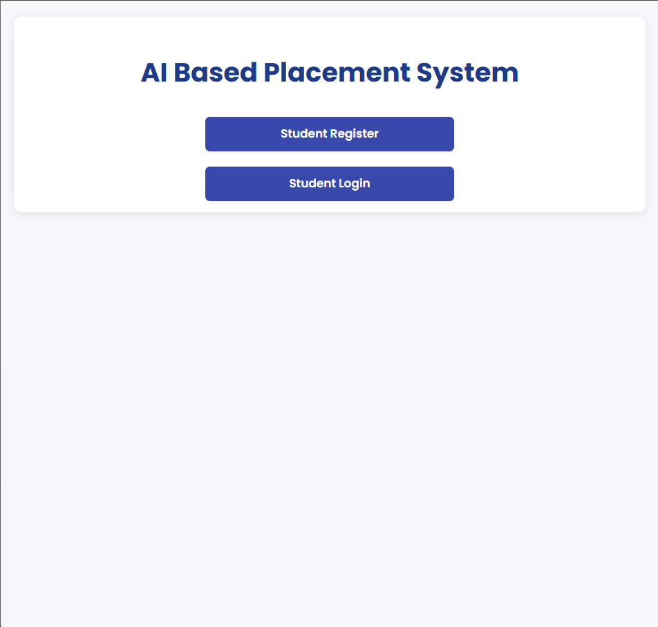
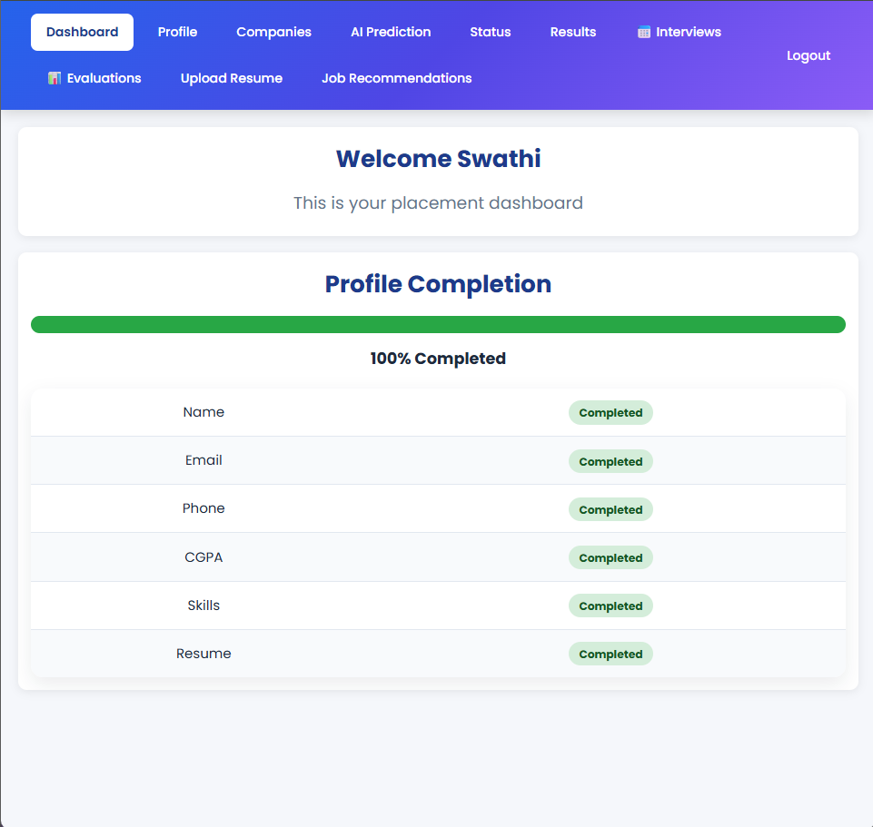
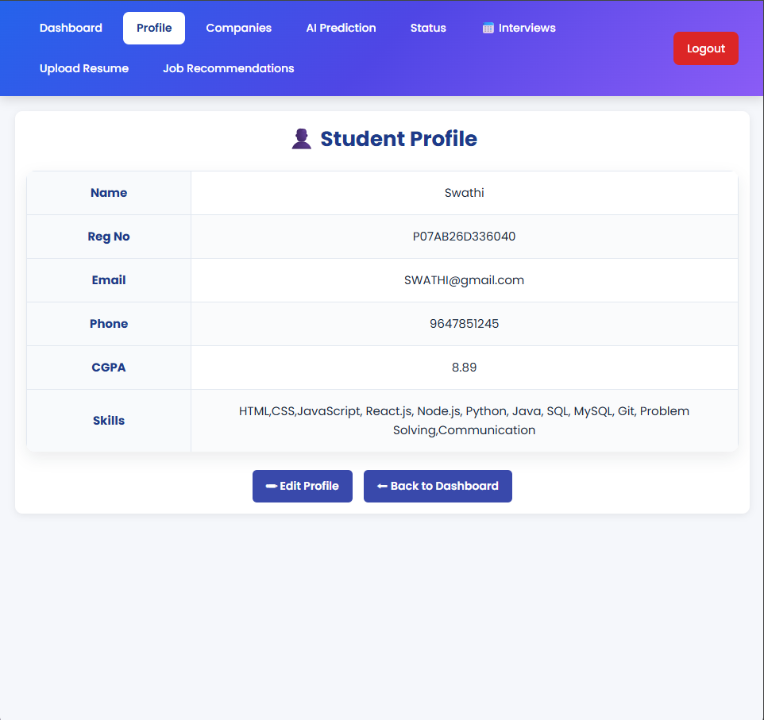
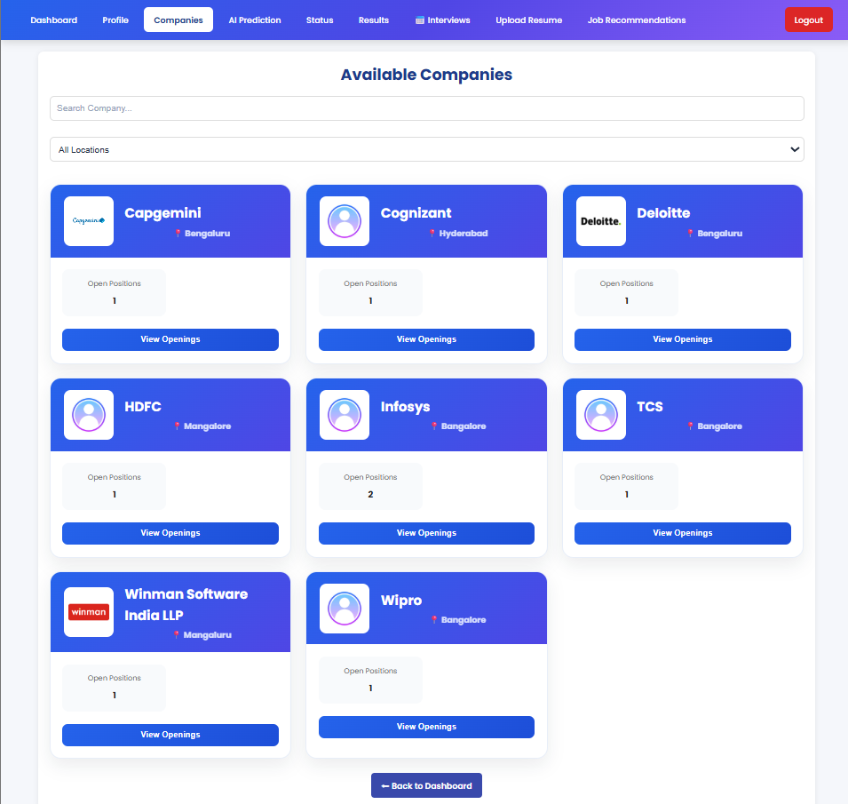
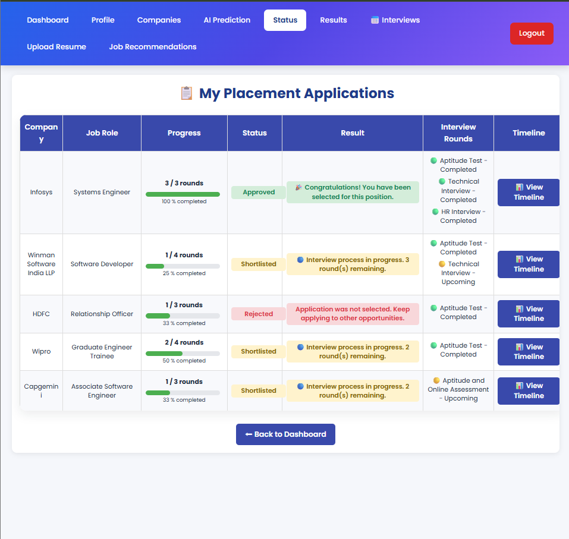
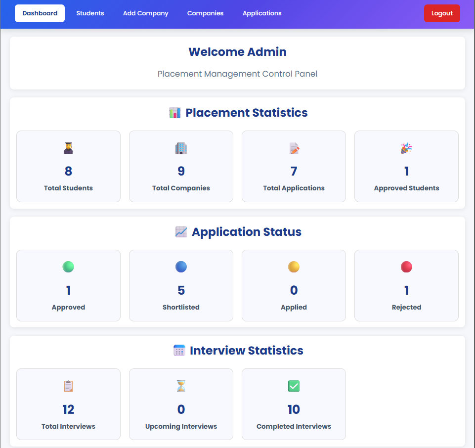
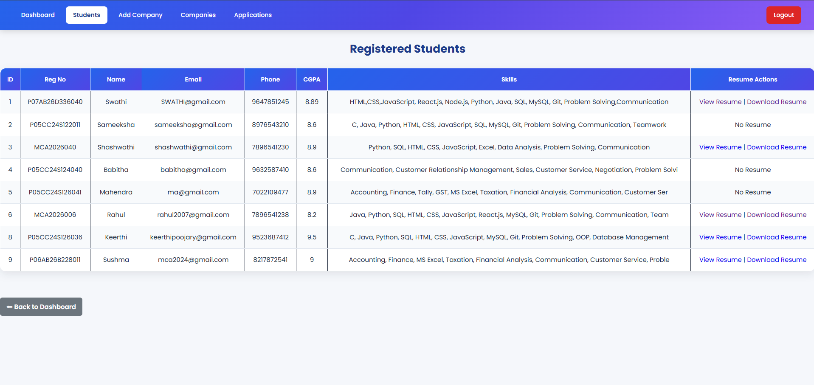
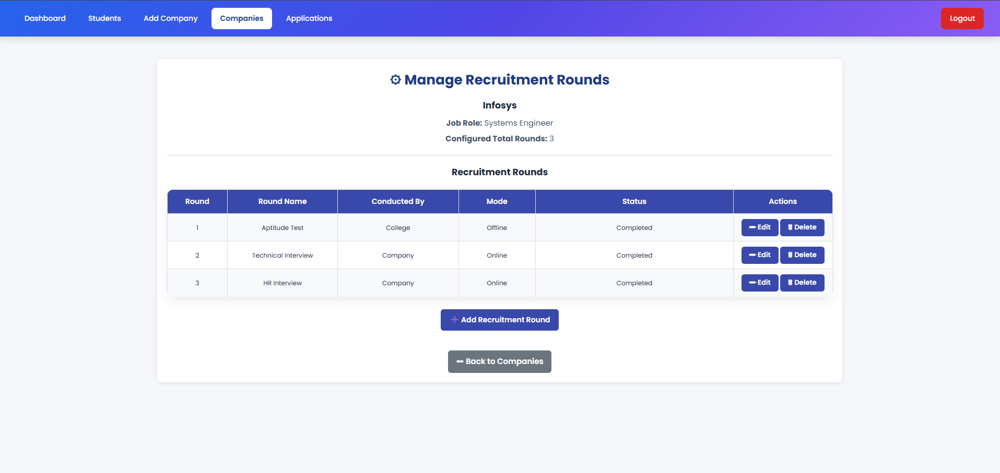
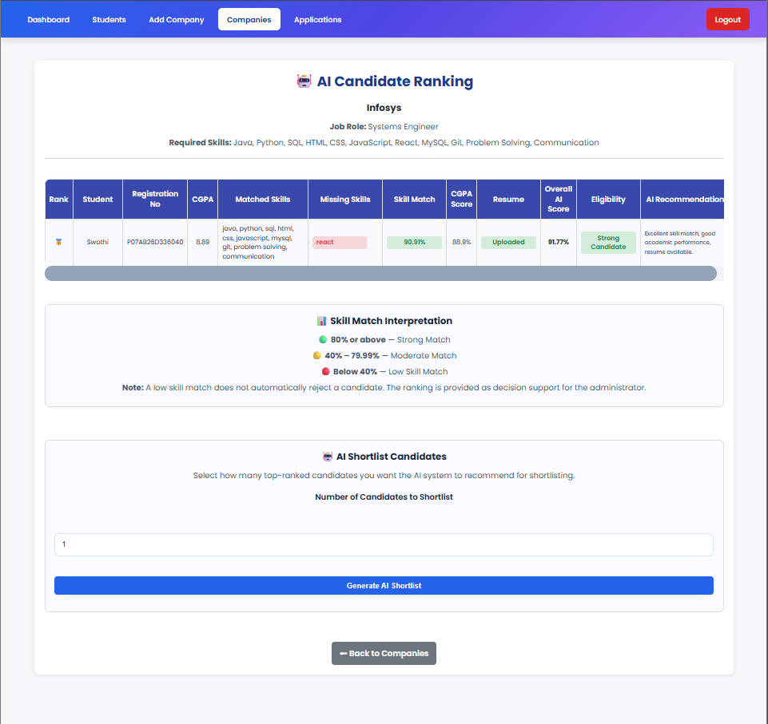
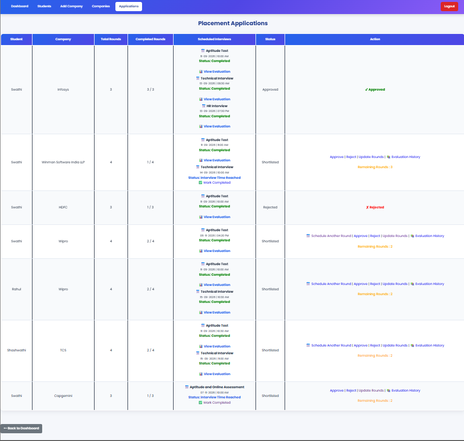

# AI-Based Placement and Recruitment Management System

An AI-assisted web application developed to simplify and manage the campus placement and recruitment process between students and placement administrators.

## About the Project

The AI-Based Placement and Recruitment Management System is designed to make the college placement process easier, faster, and more organized.

The system provides separate dashboards for students and administrators. Students can register, manage their profiles, upload resumes, apply for company opportunities, view interview schedules, and track their placement status.

Administrators can manage student details, companies, job opportunities, applications, interview rounds, and candidate evaluations. The system also provides AI-assisted candidate scoring and placement prediction to support the recruitment process.

## Project Screenshots

### 1. Home Page

### 2. Student Dashboard

### 3. Student Profile

### 4. Available Companies

### 5. My Applications

### 6. Admin Dashboard

### 7. Manage Students

### 8. Interview Rounds

### 9. AI Candidate Ranking

### 10. Placement Results

## Key Features

### Student Module
- Student registration and login
- Profile management
- Resume upload
- View available companies and job opportunities
- Apply for placement opportunities
- Track application status
- View interview schedules and results
- View placement predictions and job recommendations

### Admin Module
- Admin login and dashboard
- Manage student information
- Add and manage companies
- Manage recruitment rounds
- Review and shortlist applications
- Schedule interviews
- Evaluate student performance
- Update application and placement status
- View recruitment and placement statistics

### AI-Assisted Features
- Candidate skill score calculation
- Resume-based scoring
- CGPA-based scoring
- Candidate ranking
- Placement prediction

**Candidate Scoring Criteria:**
- Skills: 60%
- CGPA: 25%
- Resume: 15%

**Prediction Categories:**
- Strong: 80 and above
- Moderate: 60–79
- Low: Below 60

## Technologies Used

| Category | Technologies |
|---|---|
| Frontend | HTML, CSS, JavaScript |
| Backend | Core PHP |
| Database | MySQL |
| Email | PHPMailer and Gmail SMTP |
| Development Environment | XAMPP |
| Dependency Management | Composer |

## Database

Database name: `placement_management`

The project includes an SQL file containing the database structure.

## Installation and Setup

1. Install XAMPP on your computer.
2. Copy the project folder into the XAMPP `htdocs` directory.
3. Start Apache and MySQL.
4. Open phpMyAdmin and create a database named `placement_management`.
5. Import `database/placement_management.sql`.
6. Copy `database/config.example.php` and rename the copy to `config.php`.
7. Update the database connection details in `database/config.php`.
8. Copy `mail/smtp_config.example.php` and rename the copy to `smtp_config.php`.
9. Configure your Gmail address and Gmail App Password in `mail/smtp_config.php`.
10. Open the project in your browser.

**Example URL:**

`http://localhost/AI-Based-Placement-and-Recruitment-Management-System/`

**Note:** Update the database port and connection settings according to your local XAMPP configuration. Never upload actual passwords or private configuration files to GitHub.

## Project Structure

- `admin/` – Administrator module
- `student/` – Student module
- `css/` – Stylesheets
- `database/` – Database configuration examples and SQL file
- `mail/` – Email functionality and PHPMailer
- `uploads/` – Company logo uploads
- `screenshots/` – Project application screenshots

## Project Purpose

The main purpose of this project is to simplify the placement management process, reduce manual work, organize recruitment activities, and help administrators evaluate student applications more efficiently.

## Developed As

MCA Final Year Project

## Author

Swathi